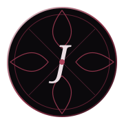

<!--
  JAPA | GitHub profile README
  Repository: https://github.com/japaaaSS
  Keep the assets/ directory beside this file.
-->

  
    
  
   
  <h1>J A P A</h1>
  <h3>CYBERSECURITY&nbsp; · &nbsp;PRIVACY&nbsp; · &nbsp;SOFTWARE</h3>
  
<i>Studying what happens beneath the surface.</i>

   
  
  
  
    
  

  <a href="#profile">PROFILE</a> &nbsp; / &nbsp;
  <a href="#areas-of-interest">AREAS OF INTEREST</a> &nbsp; / &nbsp;
  <a href="#technical-toolkit">TOOLKIT</a> &nbsp; / &nbsp;
  <a href="#github-activity">ACTIVITY</a>

<h2 align="center">01 &nbsp; / &nbsp; PROFILE</h2>

<table>
  <tr>
    <td width="58%" valign="top">
      <h3>⌁ &nbsp; A little about me</h3>
      
I'm <strong>Japa</strong>, an independent learner interested in cybersecurity, privacy, and the engineering behind the systems we use every day.

      
I like looking beneath the surface: understanding how applications communicate, how operating systems behave, how information moves, and how software can be made more reliable.

      
My approach is simple: <strong>research, experiment, document, and keep improving.</strong>

    </td>
    <td width="42%" valign="top">
      <h3>⌘ &nbsp; Profile snapshot</h3>
      
<strong>MAIN INTERESTS</strong> Cybersecurity · OSINT · Privacy

      
<strong>ALSO EXPLORING</strong> Systems · Networking · Development

      
<strong>WORK STYLE</strong> Curious · Analytical · Hands-on

      
<strong>CURRENT MODE</strong> 

    </td>
  </tr>
</table>

<h2 align="center">02 &nbsp; / &nbsp; AREAS OF INTEREST</h2>

The subjects that keep me curious and shape what I choose to learn and build.

<table>
  <tr>
    <td width="33%" valign="top" align="center">
      <h3>♜ SECURITY</h3>
      
Understanding weaknesses, defenses, and the way systems behave.

       
       
      
    </td>
    <td width="33%" valign="top" align="center">
      <h3>⌘ SYSTEMS</h3>
      
Exploring the infrastructure beneath applications and services.

       
       
      
    </td>
    <td width="33%" valign="top" align="center">
      <h3>⌘ DEVELOPMENT</h3>
      
Turning ideas into practical tools, scripts, and software.

       
       
      
    </td>
  </tr>
</table>

<h2 align="center">03 &nbsp; / &nbsp; TECHNICAL TOOLKIT</h2>

Languages and environments I explore, practice, or use in personal projects.

<h3 align="center">LANGUAGES</h3>

  

<h3 align="center">ENVIRONMENTS & TOOLS</h3>

  

One language is never enough when there is always something else worth understanding.

<h2 align="center">04 &nbsp; / &nbsp; PRINCIPLES</h2>

<table>
  <tr>
    <td width="50%" valign="top">
      <h3>01 — Understand first</h3>
      
Learn how a system works before trying to change it.

    </td>
    <td width="50%" valign="top">
      <h3>02 — Build with intent</h3>
      
Prefer useful, maintainable solutions over complexity for its own sake.

    </td>
  </tr>
  <tr>
    <td width="50%" valign="top">
      <h3>03 — Respect privacy</h3>
      
Handle information carefully and avoid collecting what is not needed.

    </td>
    <td width="50%" valign="top">
      <h3>04 — Research responsibly</h3>
      
Test only in environments I own or have explicit permission to assess.

    </td>
  </tr>
</table>

<blockquote>
  
<i>“The deeper you look, the more there is to understand.”</i>

</blockquote>

<h2 align="center">05 &nbsp; / &nbsp; GITHUB ACTIVITY</h2>

A snapshot of my public GitHub activity. Some cards may take a moment to load.

  
  
    
  
    
  

  
  <h2>J A P A</h2>
  
<strong>CODE &nbsp; · &nbsp; SECURITY &nbsp; · &nbsp; PRIVACY &nbsp; · &nbsp; CURIOSITY</strong>

  
Building quietly. Learning constantly.

  
    
  ✦ &nbsp; Thanks for visiting. &nbsp; ✦

